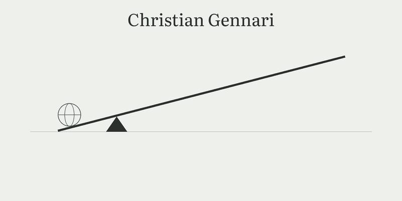

<picture>
  <source media="(prefers-color-scheme: dark)" srcset="assets/header-dark.gif">
  
</picture>

.NET developer in Hudiksvall, Sweden. I build useful software around real problems, from the database to the interface and where it runs.

## What I build

- [**Nostos**](https://nostos.page): a reading and writing environment for people who read in order to write. Open source (AGPLv3), self-hostable and available hosted. [Source](https://github.com/Christian-Gennari/Nostos)
- [**Ridealong**](https://github.com/Christian-Gennari/ridealong): a real browser for AI agents over MCP, with a live viewer and human handover. MIT.
- **Lärka**: a learning platform for students and teachers in higher vocational education, built with Viktor Johansson as our group project at Edugrade.

## Smaller tools

- [Free AI Commit Message](https://github.com/Christian-Gennari/vscode-extension-free-ai-commit-message): commit messages from the LLM provider of your choice, for [VS Code](https://github.com/Christian-Gennari/vscode-extension-free-ai-commit-message) and [JetBrains](https://github.com/Christian-Gennari/jetbrains-plugin-free-ai-commit-message)
- [Scriptorium](https://github.com/Christian-Gennari/Scriptorium): a self-hosted writing app that saves plain Markdown files
- [UbuntuSafeSnap](https://github.com/Christian-Gennari/UbuntuSafeSnap): a .NET CLI that backs up and restores an Ubuntu setup
- [OllamaRadar](https://github.com/Christian-Gennari/OllamaRadar)
- [clipbeam](https://github.com/Christian-Gennari/clipbeam): sends clipboard screenshots from Windows to a remote Linux server
- [Intentional Pause](https://github.com/Christian-Gennari/intentional-pause): a small page that interrupts a visit to a distracting site

## Background

I co-founded a media production company, Toginta Productions, and hold a BA in political science from Mid Sweden University. I am finishing my .NET studies at Edugrade, with a 22-week internship at Statens tjänstepensionsverk (SPV) in Sundsvall from November 2026 to April 2027. Microsoft AZ-900 certified (February 2026). I read classics and philosophy.

## Contact

[dev.cgennari.com](https://dev.cgennari.com) · [contact@cgennari.com](mailto:contact@cgennari.com) · [LinkedIn](https://www.linkedin.com/in/christiangennari)
